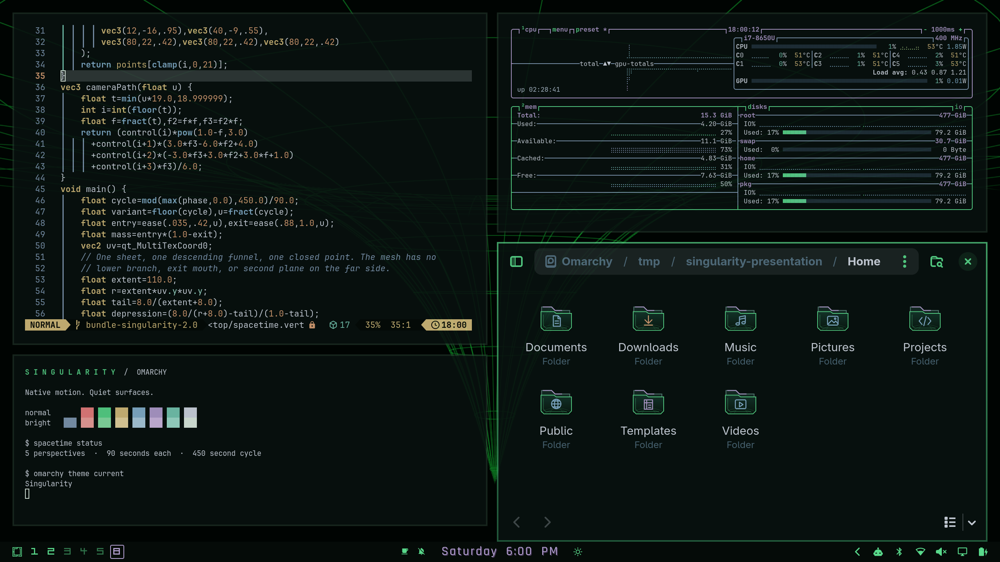
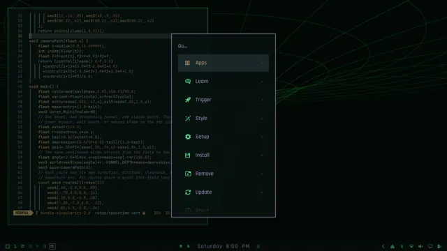
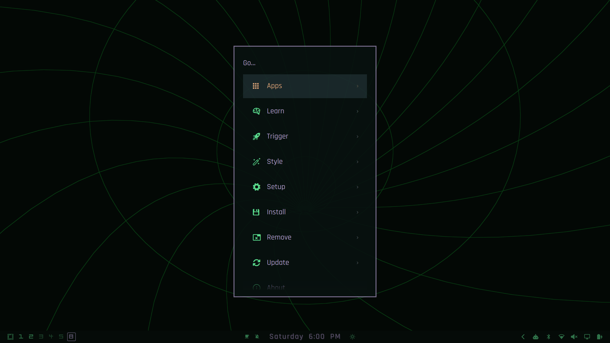
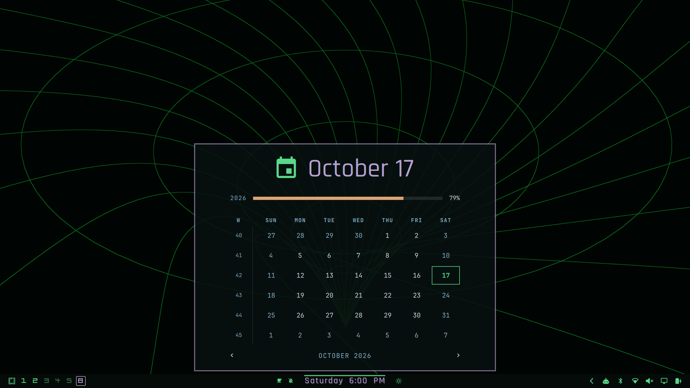
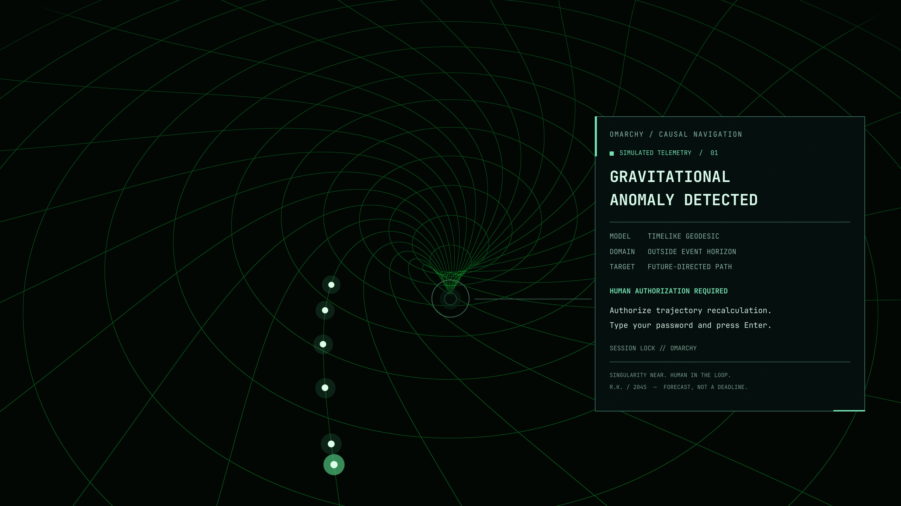
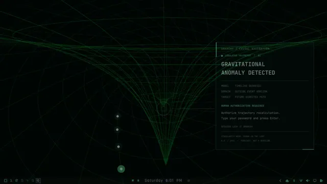
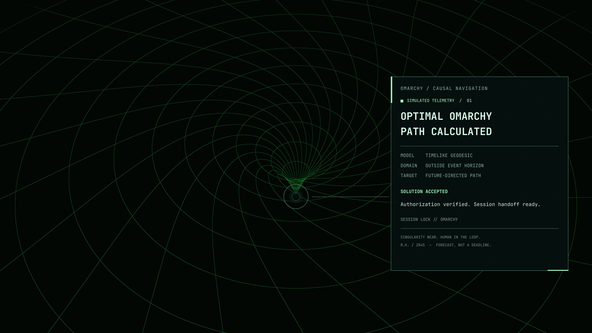
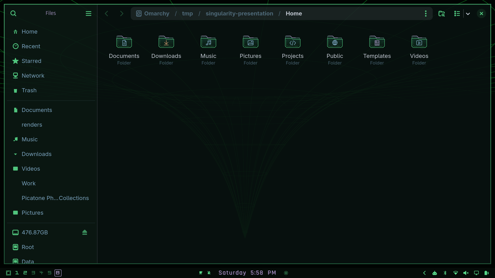
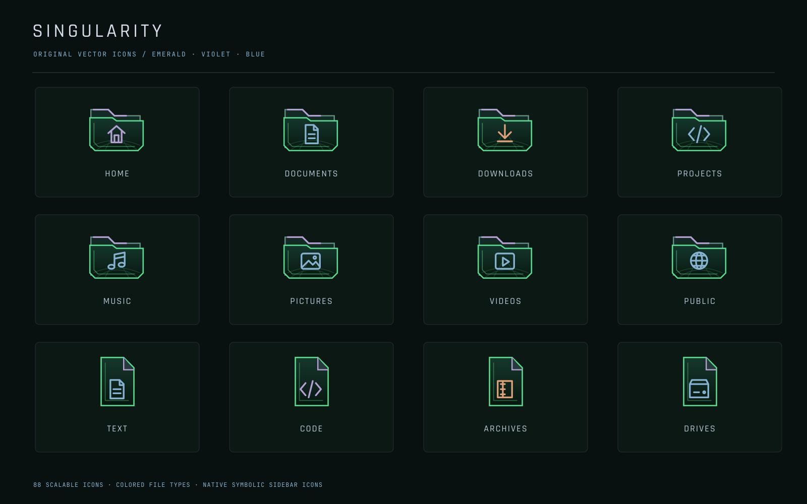

# Singularity in motion

Native Omarchy captures from the completed theme. The selector image follows
the stock theme gallery's four-app composition: editor, terminal palette,
resource monitor and Files. All screenshots are 2560×1440.

## A living workspace

The mesh remains visible through the terminal workspace and quiet, translucent
menu surfaces. Emerald controls, violet headings, blue details and orange
selections extend into native applications.

[MP4 preview](media/desktop-and-menus.mp4) ·
[Complete 90-second native camera route](media/desktop-journey.mp4)

The menu clip contains 96 distinct native frames at 12 fps. Desktop shader time
is stepped at 1/12 second per frame, preserving the animation's normal pacing.
The complete route is the previously validated native 24 fps export; its shader
sources match this release. Neither video uses frame interpolation.

## Authentication as part of the theme

A stationary mesh carries the password's masked dots along a curved meridian.
The same visual language accompanies the causal-navigation HUD and successful
path acknowledgement.

[MP4 lock preview](media/lock-password-trail.mp4)

The compact lock clip is a time-compressed visual preview: 96 native captures
spanning approximately 27 seconds are presented in eight seconds. Dots and
success states are synthetic; no real password or authentication event was
recorded. Dot motion is presentation only and never expires the native input.

## File explorer and system utilities

Files uses the same pine surfaces, emerald controls and blue details as the
shell. GTK application geometry stays native. Files, utility windows and
terminals use 90% focused / 88% unfocused compositing.

Temporary demo folders use their category-specific installed icons. Real home
folders resolve the corresponding standard icon names through the icon theme.
The new family includes folders, file types, devices and symbolic sidebar icons;
other application icons inherit from the installed system themes.

